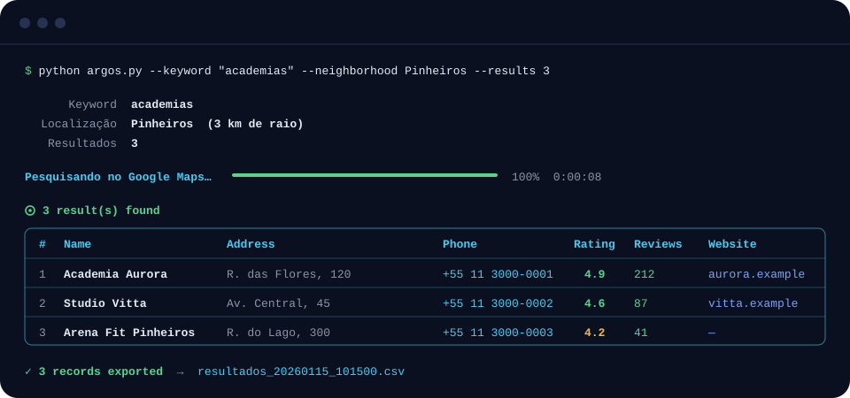
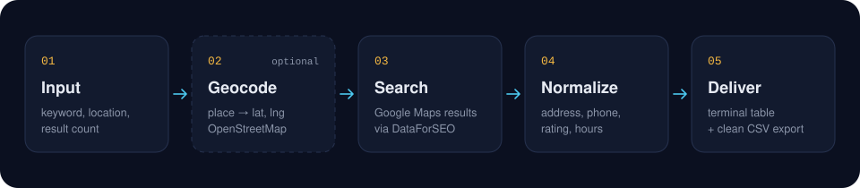
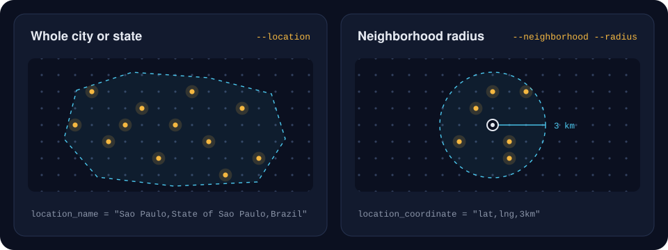
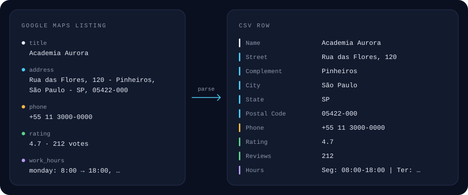

<p align="center">
  
</p>

<p align="center">
  
  
  
  
</p>

**Argos** is a command-line tool that turns a Google Maps search into a clean, structured lead list. Give it a business type and a place — a state, a city, or a single neighborhood — and it returns every matching business with address, phone, rating, website, hours and coordinates, shown in the terminal and exported to a CSV you can open in a spreadsheet or import anywhere.

It works for any kind of business: gyms, restaurants, clinics, law firms, pet shops.

The name comes from *Argos Panoptes*, the hundred-eyed giant of Greek mythology who never closed all his eyes at once.

<p align="center">
  
  <br>
  <sub>Illustrative output with sample data.</sub>
</p>

## Why

Prospecting local businesses by hand means opening Google Maps, copying names and phone numbers one by one, and cleaning everything up in a spreadsheet afterwards. Argos collapses that into one command:

- **One search, up to 700 businesses.** Pick how deep to go.
- **Neighborhood precision.** Name a neighborhood and a radius; Argos finds its coordinates for you.
- **Data that is already clean.** One row per business, one fact per column, with addresses split into street, complement, city, state and postal code.
- **No setup friction.** On first run it asks for your API credentials and saves them.

## How it works

<p align="center">
  
</p>

1. **Input** — search parameters come from CLI flags or from an interactive prompt.
2. **Geocode** *(only when a neighborhood is given)* — the neighborhood name is resolved to latitude and longitude through OpenStreetMap's Nominatim.
3. **Search** — a single live request to the [DataForSEO](https://dataforseo.com) Google Maps API returns the listings.
4. **Normalize** — each listing is parsed: address components, phone parts, rating bucket, opening hours.
5. **Deliver** — results are rendered as a table in the terminal and written to CSV.

## Quick start

**Requirements:** Python 3.10+ and a [DataForSEO](https://dataforseo.com) account with API credentials.

```bash
git clone https://github.com/RafaelFariaFerreira/Argos.git
cd Argos

python3 -m venv .venv
source .venv/bin/activate        # Windows: .venv\Scripts\activate
pip install -r requirements.txt

python argos.py
```

On the first run Argos asks for your DataForSEO login and password and stores them in a local `.env` file (already git-ignored). To set them by hand instead:

```env
DATAFORSEO_LOGIN=your@email.com
DATAFORSEO_PASSWORD=your_password
```

Credentials are available at [app.dataforseo.com/api-access](https://app.dataforseo.com/api-access).

## Usage

Run with no search flags and Argos asks for everything interactively:

```
  Tipo de empresa / termo de busca (ex.: academias): academias
  Estado: São Paulo
  Cidade: São Paulo
  Bairro (opcional — Enter para pular): Pinheiros
  Raio de busca (km): 3
  Número de resultados (máximo: 700): 50
```

Pass `--keyword` (plus any other flag) and it runs straight through, which is what you want for scripts and repeated searches.

### Two ways to define the area

<p align="center">
  
</p>

| Mode | Flags | Best for |
|---|---|---|
| **Whole city or state** | `--location` | Sizing a market, building a broad list |
| **Neighborhood radius** | `--neighborhood` + `--radius` | Hyper-local prospecting, territory planning |

### Options

| Option | Description | Default |
|---|---|---|
| `--keyword` | Type of business to search for | required |
| `--location` | City or state, in DataForSEO format | `Sao Paulo,State of Sao Paulo,Brazil` |
| `--neighborhood` | Neighborhood name, geocoded automatically | — |
| `--radius` | Radius in km around the neighborhood | `3` |
| `--results` | How many results to fetch (1–700) | `20` |
| `--language` | Search language | `Portuguese` |
| `--output` | CSV file path | `resultados_<timestamp>.csv` |
| `--no-export` | Show results only, skip the CSV | off |

### Examples

```bash
# Gyms within 3 km of Pinheiros, São Paulo
python argos.py --keyword "academias" --neighborhood "Pinheiros"

# Tighter radius
python argos.py --keyword "academias" --neighborhood "Vila Mariana" --radius 1

# A neighborhood in another city
python argos.py --keyword "restaurantes" \
  --location "Rio de Janeiro,State of Rio de Janeiro,Brazil" \
  --neighborhood "Ipanema"

# 100 results across a whole city, saved to a named file
python argos.py --keyword "pet shops" \
  --location "Curitiba,State of Parana,Brazil" \
  --results 100 --output petshops_curitiba.csv

# Just look, don't save
python argos.py --keyword "escritórios de advocacia" --no-export
```

### Location format

In interactive mode you just type the city and state as you normally would (`São Paulo`, `Paraná` or `PR`); Argos converts them to the format below. With flags, `--location` must match a name in DataForSEO's location database. For Brazil the pattern is `City,State of <state name without accents>,Brazil`:

```
Sao Paulo,State of Sao Paulo,Brazil
Rio de Janeiro,State of Rio de Janeiro,Brazil
Belo Horizonte,State of Minas Gerais,Brazil
Brasilia,Federal District,Brazil
Curitiba,State of Parana,Brazil
```

Drop the city to search an entire state: `State of Sao Paulo,Brazil`.

## Output

Every listing is reshaped from the free-form text Google Maps shows into separate, typed fields.

<p align="center">
  
</p>

The CSV has 15 columns:

| Column | Content |
|---|---|
| `Name` | Business name |
| `Category` | Category as shown on Google Maps |
| `Phone` | Phone number |
| `Website` | Website domain |
| `Rating` | Average Google rating |
| `Reviews` | Number of Google reviews |
| `Address` | Full address line, as shown on Google Maps |
| `Street` · `Complement` | Street and number · complement or neighborhood |
| `City` · `State` · `Postal Code` | Parsed from the address line |
| `Hours` | Opening hours, e.g. `Seg: 08:00-18:00 \| Ter: 08:00-18:00` |
| `Latitude` · `Longitude` | Coordinates |

Address splitting expects the Brazilian format (`street - complement, city - UF, CEP`). For anything else, the full line is still in `Address`.

## Built with

| | |
|---|---|
| [DataForSEO](https://dataforseo.com) | Google Maps search results |
| [geopy](https://github.com/geopy/geopy) + OpenStreetMap Nominatim | Neighborhood geocoding |
| [Rich](https://github.com/Textualize/rich) | Terminal tables, prompts and progress |
| [Requests](https://github.com/psf/requests) · [python-dotenv](https://github.com/theskumar/python-dotenv) | HTTP and credential loading |

The whole tool is a single file, [`argos.py`](argos.py).

## License

MIT — see [LICENSE](LICENSE).
